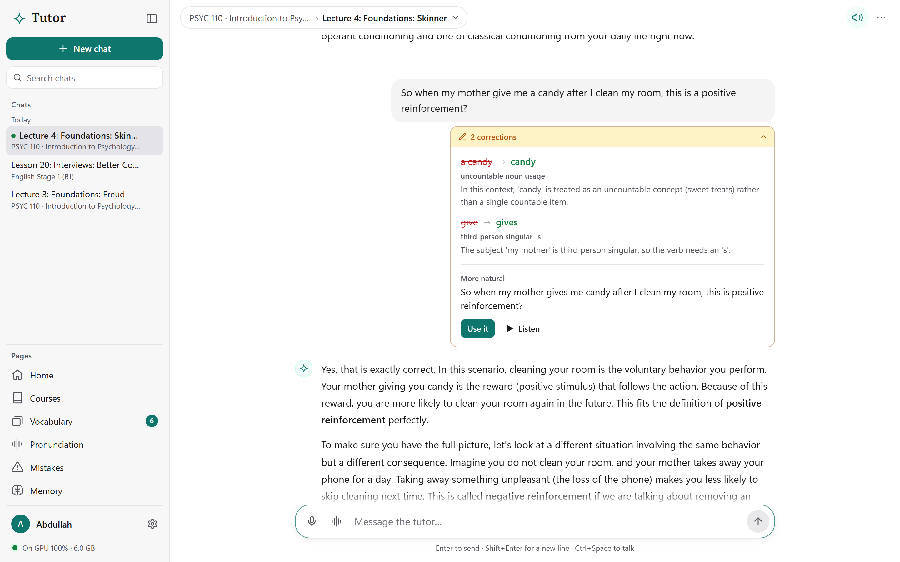
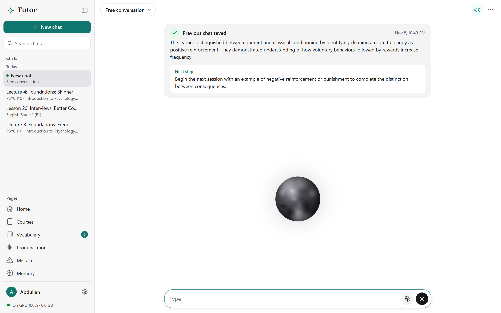
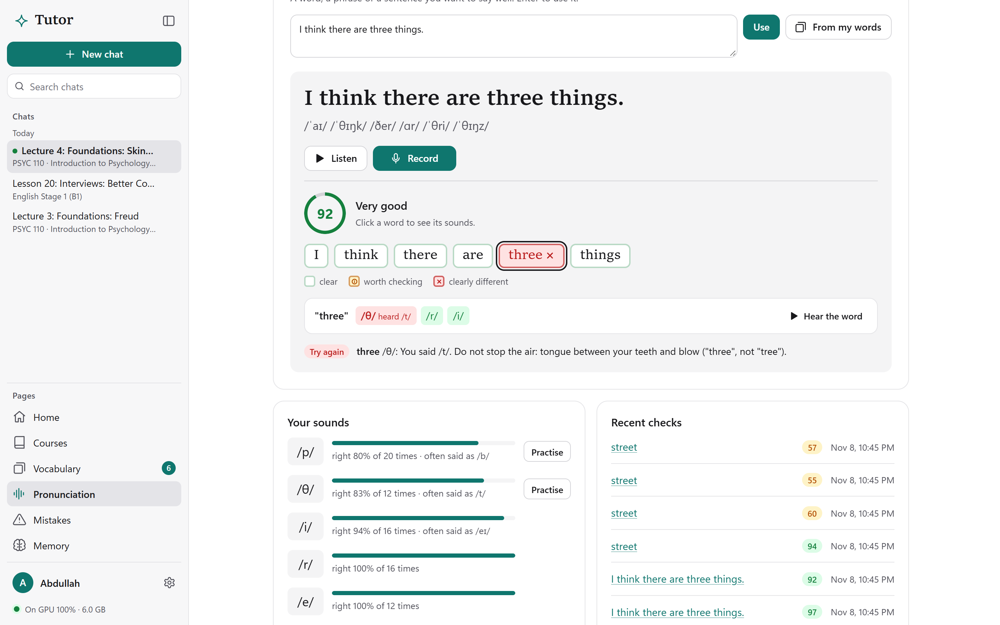
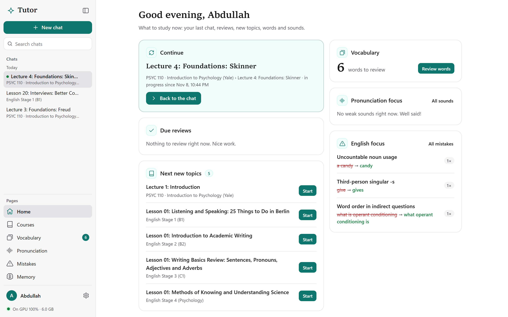
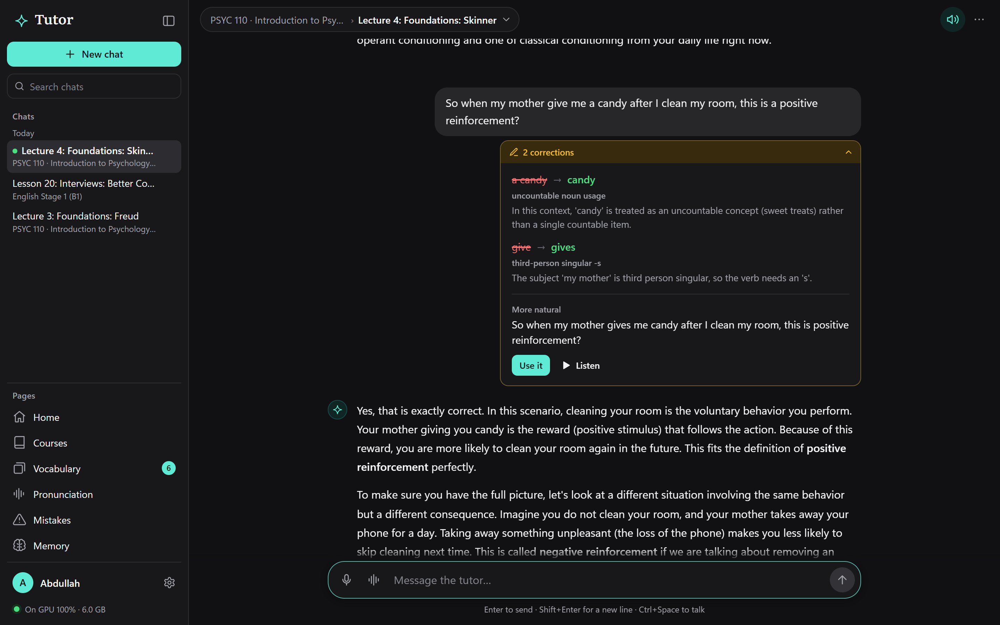
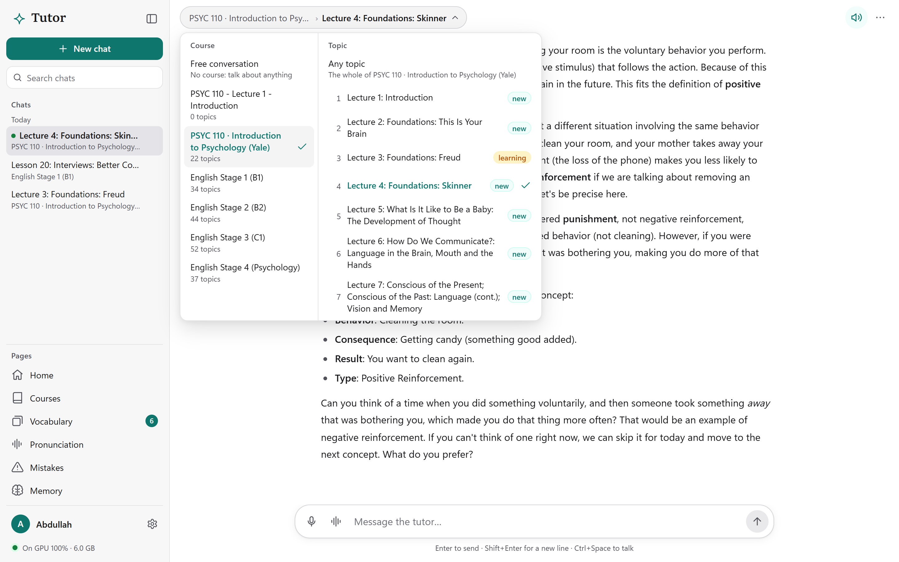
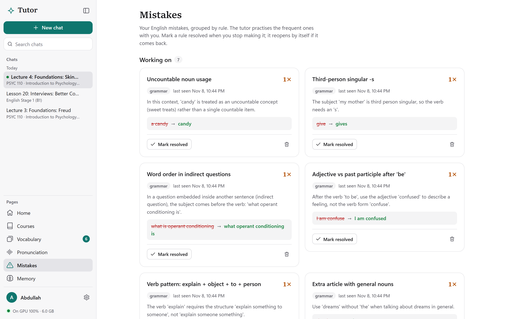
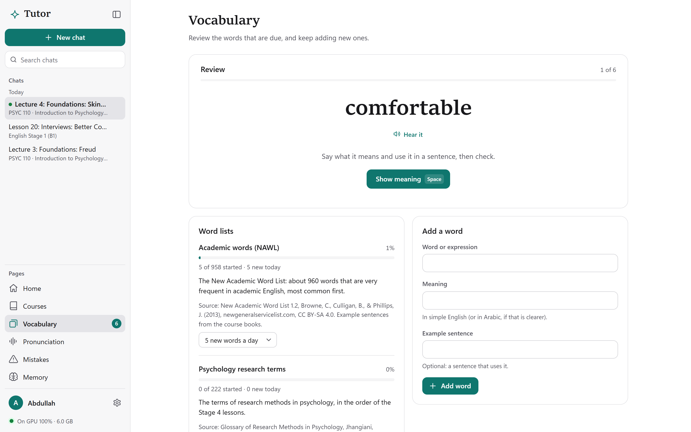
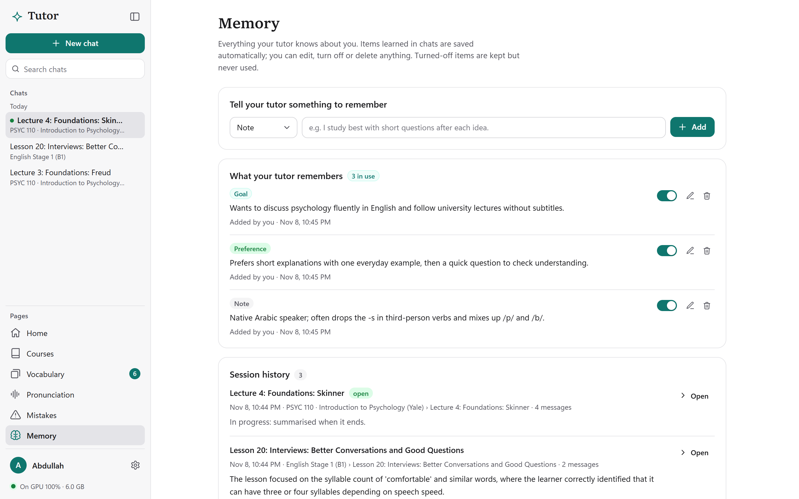

<div dir="rtl">

<div align="center">


# Personal Tutor: المعلم الشخصي

**صديق دراسة صوتي بالذكاء الاصطناعي، يدرّسك أي مادة ويحسّن إنجليزيتك أثناء الدراسة، ويعمل بالكامل على كرت الشاشة في جهازك دون إنترنت ودون أن تغادر بياناتك حاسوبك.**

[English](README.md) · **العربية** · [دليل التثبيت](docs/INSTALL.ar.md) · [دليل الاستخدام الكامل](docs/USER_GUIDE.ar.md)



<sub>جلسة حقيقية: المعلم يشرح محاضرة سكينر من مقرر PSYC 110 في جامعة Yale، ويصحّح إنجليزية المتعلم تحت رسالته دون أن يقطع الدرس. كل الصور هنا من التطبيق وهو يعمل محلياً على RTX 5060 Ti.</sub>

</div>

---

## لماذا بنيت هذا المشروع؟

كانت لغتي الإنجليزية ضعيفة، وكان هذا يعيقني. أستطيع القراءة قليلاً، لكن المشكلة الحقيقية كانت في التحدث: لم يكن لدي من أتدرب معه، وكنت أخجل من الخطأ أمام الناس، والدروس مكلفة ولا تتناول إلا مواضيع "اللغة" نفسها. **ما أردته فعلاً هو صديق صبور أتحدث معه بصوتي** عن *أي شيء*: محاضرات علم النفس، والعلوم، والحياة اليومية، ويصحح قواعدي ونطقي بهدوء ونحن نتحدث عمّا يهمني فعلاً.

الأدوات التي وجدتها لم تفعل ذلك. تطبيقات اللغة تعلّم تمارين مفردات لا محادثات في مواد حقيقية، وروبوتات المحادثة العامة لا تتذكر أخطاءك ولا تتابع الأصوات التي تصعب عليك، وترسل كل ما تقوله إلى السحابة.

فبنيت ما أحتاجه: **صديقاً صوتياً يعمل بالكامل على حاسوبي.** يدرس معي مقررات جامعية حقيقية، ويتحدث معي بصوت مسموع، ويقاطعني وأقاطعه كالبشر، ويتذكر ما يصعب عليّ، ويحوّل كل محادثة إلى تدريب على الإنجليزية.

وهذا المشروع أيضاً **نموذج من أعمالي كمطوّر فول ستاك (Full-Stack)**، يغطي كل الطبقات من البداية إلى النهاية: معالجة صوت في الزمن الحقيقي، وتنسيق نماذج لغوية كبيرة، وقاعدة بيانات بالبحث النصي الكامل، وتشغيل نماذج ضمن حدود ذاكرة كرت الشاشة، وواجهة مبنية يدوياً تراعي إمكانية الوصول، ومثبّت ويندوز بنقرة واحدة، واختبارات تشغّل الواجهة في متصفح حقيقي.

> أشاركه مع كل المواد الدراسية التي أعددتها، لينتفع به كل من يمر بما مررت به.

---

## ماذا يفعل؟

| | |
|---|---|
| 🎙️ **محادثة صوتية حية** | تحدث بشكل طبيعي دون أزرار. يعرف المعلم أنك أنهيت كلامك من الصمت **ومن معنى الجملة** (ينتظر أطول بعد *"because…"*)، وتستطيع مقاطعته متى شئت فيسكت خلال 0.4 ثانية تقريباً. |
| 📚 **يدرّس أي مادة** | ارفع ملفات PDF أو TXT أو Markdown، أو استخدم المقررات الستة المرفقة. الإجابات مبنية على مادتك مع إحالات قابلة للنقر `[S1]`، وتستطيع السؤال بالعربية عن مادة إنجليزية. |
| ✍️ **يصحّح إنجليزيتك أثناء الحديث** | كل رسالة منك، مكتوبة أو منطوقة، تُفحص في الخلفية: الخطأ والقاعدة وشرح قصير وصياغة أفضل، مع زرّي **Use it** و**▶ Listen**. |
| 🗣️ **مدرّب نطق** | قل جملة فيُقيَّم كل صوت فيها مقابل القاموس، ويُعرض لك ما سُمع بدله (*"/θ/ سُمعت /t/"*) مع نصيحة لتصحيحه، و13 تمريناً مصمماً لمتحدثي العربية. |
| 🧠 **ذاكرة طويلة المدى** | يتذكر أهدافك وتفضيلاتك وأخطاءك المتكررة وأصواتك الأضعف ومفرداتك، ويلخّص كل جلسة مع *الخطوة التالية*. ترى كل ما يتذكره وتعدّله أو توقفه أو تحذفه. |
| 🗂️ **تكرار متباعد** | الكلمات التي تسأل عنها والمواضيع التي تنهيها تعود للمراجعة بفواصل متزايدة (1، 3، 7، 14، 30، 60 يوماً)، مع قائمتي كلمات أكاديمية (958 + 222 كلمة). |
| 🔤 **نطق ثنائي اللغة** | الكلمات العربية داخل إجابة إنجليزية تُنطق بصوت عربي (SILMA TTS) في الجملة نفسها: *"Cognitive means **إدراكي**…"*. |
| 🔒 **الخصوصية أولاً** | لا شيء يغادر جهازك. الخادم يستمع على `127.0.0.1` فقط ويرفض الطلبات من مواقع أخرى، وتسجيلاتك الصوتية لا تُحفظ. |

<table>
<tr>
<td width="50%"><br><sub><b>الوضع الصوتي:</b> حركة الكرة تدل على الحالة (يستمع، يفكر، يتكلم). البطاقة فوقها ملخص المحادثة السابقة الذي يُكتب تلقائياً.</sub></td>
<td width="50%"><br><sub><b>النطق:</b> كل صوت يُقيَّم، فتُكتشف "three" المنطوقة "tree" مع نصيحة لتصحيحها.</sub></td>
</tr>
<tr>
<td><br><sub><b>الرئيسية:</b> ماذا تدرس الآن: أكمل من حيث توقفت، المراجعات المستحقة، أضعف أصواتك وأكثر أخطائك تكراراً.</sub></td>
<td><br><sub><b>الوضع الداكن</b>، ويتبع إعداد ويندوز تلقائياً.</sub></td>
</tr>
<tr>
<td><br><sub><b>اختيار المقرر والموضوع</b> (<kbd>Ctrl</kbd>+<kbd>K</kbd>) مع حالة كل موضوع.</sub></td>
<td><br><sub><b>الأخطاء</b> مجمّعة حسب القاعدة، والمعلم يعيد المتكرر منها إلى الحديث.</sub></td>
</tr>
<tr>
<td><br><sub><b>المفردات</b> بالتكرار المتباعد (<kbd>Space</kbd> ثم <kbd>1</kbd>–<kbd>4</kbd>).</sub></td>
<td><br><sub><b>الذاكرة:</b> كل ما يعرفه المعلم عنك، وكله تحت سيطرتك.</sub></td>
</tr>
</table>

---

## المواد الدراسية المرفقة (مجانية للجميع)

يحتوي المستودع على **كل المواد الدراسية التي أعددتها**: نحو 190 درساً مع أدلة دراسة ومفاتيح إجابات وملفات PDF جاهزة للطباعة، مبنية من مقررات جامعية وكتب مفتوحة الترخيص. يحمّلها المثبّت في التطبيق تلقائياً.

| المقرر | الدروس | المصدر |
|---|---|---|
| **PSYC 110: مقدمة في علم النفس** | 22 | جامعة Yale (Paul Bloom)، Open Yale Courses: النصوص والشرائح ودليل دراسة لكل محاضرة |
| **English Stage 1 (B1)**: المحادثة والاستماع والنطق | 34 | Zemlick وFerguson (Grossmont College)، مع التسجيلات الصوتية للكتب |
| **English Stage 2 (B2)**: القواعد والكتابة الأكاديمية | 44 | Al Haider (Reedley College) وCui (Harper College) |
| **English Stage 3 (C1)**: القراءة الأكاديمية والبحث والكتابة | 52 | Hall وWallace (Georgia State) وWiner وWadell (ASCCC OERI) |
| **English Stage 4**: الإنجليزية لعلم النفس (مناهج البحث) | 37 | Jhangiani وChiang وCuttler وLeighton، *Research Methods in Psychology* |
| **قوائم الكلمات** | 958 + 222 | New Academic Word List (NAWL) ومسرد مصطلحات مناهج البحث |

كل دليل دراسة مكتوب من نص المصدر، والأرقام والأسماء وعلامات النبر فُحصت آلياً. ملفات الطباعة في `materials/library/<المقرر>/print/`، والتراخيص في [materials/README.md](materials/README.md).

---

## المتطلبات

| | الحد الأدنى | الموصى به (ما قيست عليه الأرقام) |
|---|---|---|
| النظام | ويندوز 10 أو 11 (64-بت) | ويندوز 11 |
| كرت الشاشة | NVIDIA بذاكرة **12 GB** وتعريف حديث | NVIDIA بذاكرة **16 GB** (RTX 5060 Ti 16GB) |
| المساحة | 25 GB فارغة | 40 GB (مع الصوت العربي) |
| الرام | 16 GB | 32 GB |
| أخرى | إنترنت للتنزيل أول مرة فقط، ومتصفح Chrome أو Edge | سماعات رأس للوضع الصوتي |

## التشغيل السريع

1. **نزّل المشروع:** من زر **Code** الأخضر اختر **Download ZIP**، ثم فك الضغط في قرص فيه مساحة كافية (مثل `D:\personal-tutor`). أو استنسخه بـ Git.
2. **انقر نقراً مزدوجاً على `Install Personal Tutor.cmd`:** ينزّل كل شيء داخل المجلد (Ollama وPython والنماذج)، ويحمّل المقررات، وينشئ اختصاراً على سطح المكتب. لا يحتاج صلاحيات مدير، ويمكن إعادة تشغيله بأمان.
3. **انقر نقراً مزدوجاً على `Start Personal Tutor.cmd`** (أو الاختصار): يفتح التطبيق في نافذة مستقلة. و`Stop Personal Tutor.cmd` يوقفه ويحرر ذاكرة كرت الشاشة.

📖 **[دليل التثبيت خطوة بخطوة](docs/INSTALL.ar.md)**: المتطلبات، وما تفعله كل خطوة، وحل المشكلات.

---

## كيف يعمل؟

<div dir="ltr">

```
المتصفح (JavaScript بلا إطار عمل)  ──REST + SSE──▶  خادم FastAPI (127.0.0.1)  ──▶  Qwen 3.5 9B عبر Ollama (GPU)
   الميكروفون ──WebSocket──▶  الصوت الحي: Silero VAD ◀──▶ Whisper (GPU)  ──▶  المعلم  ──جمل──▶  Kokoro / SILMA (GPU)
                                    SQLite + FTS5: المقررات والمقاطع والذاكرة والمراجعات
```

</div>

**دورة رسالة واحدة:**

1. **البحث:** سؤالك (يُحوَّل إلى كلمات إنجليزية إن كان بالعربية) يبحث في مقاطع المقرر بـ SQLite FTS5، والموضوع الحالي أولاً.
2. **السياق:** يُبنى البرومبت من ملفك الشخصي، وأهم ذكرياتك، وأخطائك المتكررة، وأصواتك الأضعف، والكلمات المستحقة، وموقعك في المنهج، والمقاطع مع أرقام مصادرها.
3. **البث:** الرد يصل كلمة كلمة، وفي الوضع الصوتي تُنطق كل جملة فور اكتمالها قبل أن ينتهي الرد كله.
4. **المراقبة:** بالتوازي يحلل "المراقب" رسالتك أنت. التصحيح يُقبل فقط إن كانت الكلمات الخاطئة موجودة فعلاً فيما قلته، **والنموذج لا يكتب في قاعدة البيانات مباشرة أبداً**.
5. **التلخيص:** عند إنهاء الجلسة يُكتب ملخص و*خطوة تالية* وذكريات جديدة إن وُجد دليل عليها.

### أبرز الجوانب الهندسية

- **صوت في الزمن الحقيقي على جهاز منزلي:** تحويل الكلام إلى نص ثم النموذج ثم الصوت، كله بالبث، مع كشف نهاية الدور بالمعنى والمقاطعة، ونحو **1.9 ثانية** من نهاية كلامك حتى صوت المعلم، كل ذلك محلياً.
- **إدارة ذاكرة كرت الشاشة:** نموذج واحد وطلب واحد في كل مرة، وكل الطبقات على الكرت، ونموذج النطق يُحمَّل عند الحاجة بعد التحقق من الذاكرة الحرة ويُفرَّغ بعد 10 دقائق. كل شيء يتسع في 13 GB.
- **تقييم نطق بدقة مقاسة:** Goodness of Pronunciation فوق نموذج wav2vec2 مدرّب على متعلمين منهم متحدثون بالعربية. العتبات ضُبطت على نصف متحدثي *speechocean762* وقيست على النصف الآخر: **2% إنذارات خاطئة**.
- **واجهة بلا إطار عمل وبلا خطوة بناء:** وحدات ES، ووضعان فاتح وداكن، ودعم كامل للوحة المفاتيح، و[مواصفات تصميم](app/tutor/web/DESIGN.md) يفحصها اختبار آلي في Chrome يتحقق أيضاً من تباين النصوص.
- **مثبّت محمول:** إصدارات مثبتة، وكل شيء داخل مجلد المشروع، ويُكمل من حيث توقف.

**التقنيات:** Python 3.12 وFastAPI وSQLite FTS5 وOllama (Qwen 3.5 9B) وfaster-whisper وKokoro ONNX وSILMA TTS وwav2vec2 ONNX وeSpeak NG وJavaScript وWeb Audio API وpytest.

---

## الترخيص

- **الكود:** رخصة [MIT](LICENSE).
- **المواد الدراسية** في `materials/` تحتفظ برخص Creative Commons الأصلية (بعضها للاستخدام غير التجاري فقط). التفاصيل في [materials/README.md](materials/README.md).
- **النماذج** تُنزَّل عند التثبيت برخصها الخاصة (Apache 2.0 وMIT).

## المطوّر

**عبدالله**، مطوّر فول ستاك. بنيت هذا المشروع لأني احتجت شريكاً صبوراً أتحدث معه بالإنجليزية.
إن ساعدك المشروع في ممارسة اللغة فنجمة ⭐ على المستودع تسعدني، والاقتراحات والملاحظات مرحّب بها.

</div>
