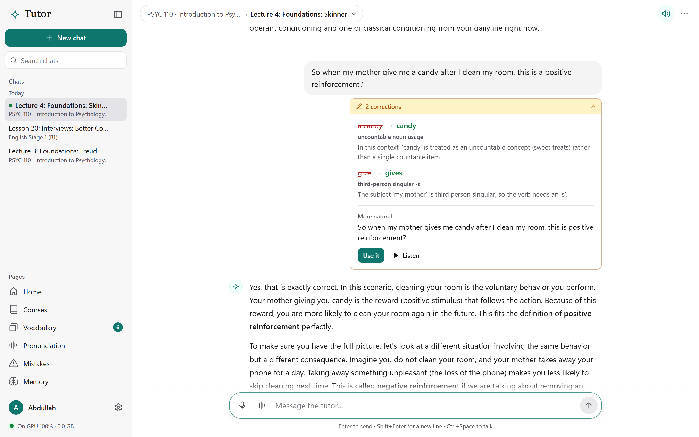
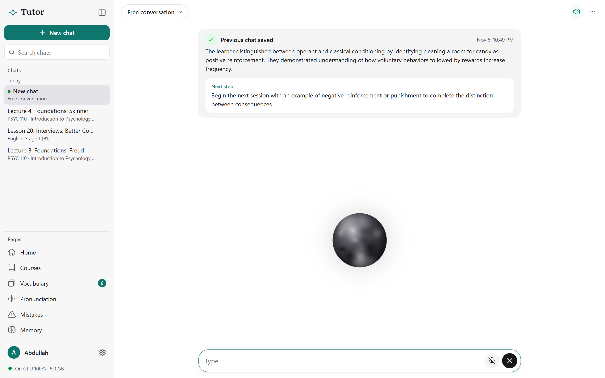
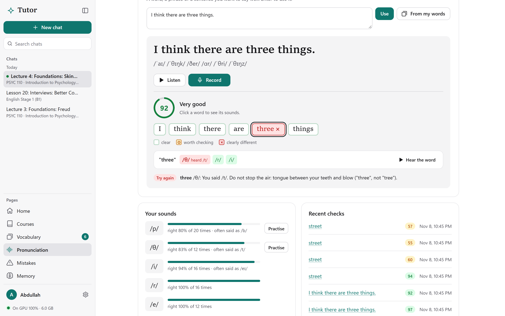
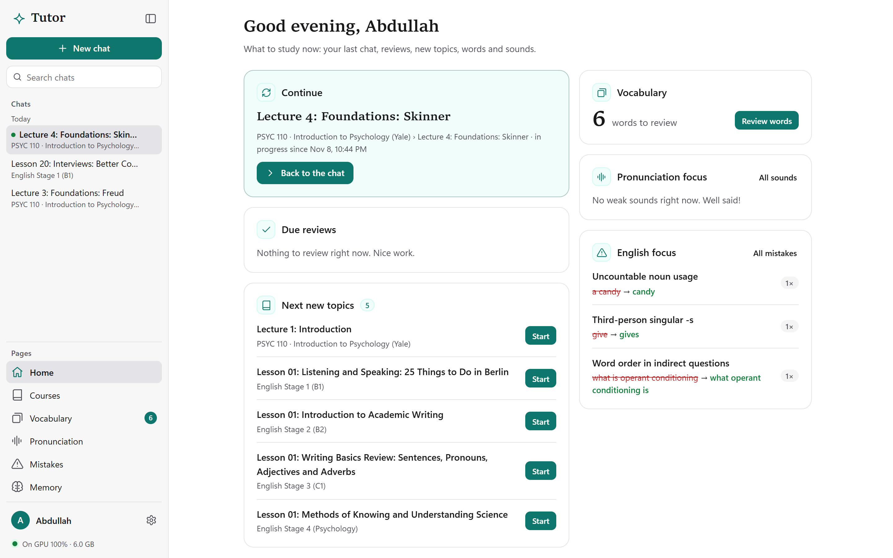
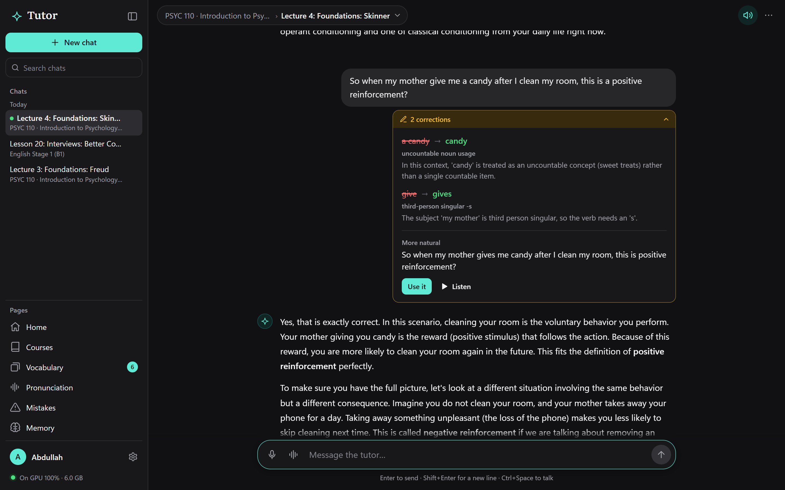
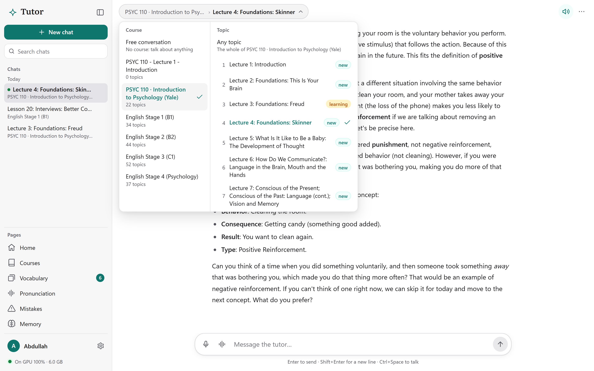
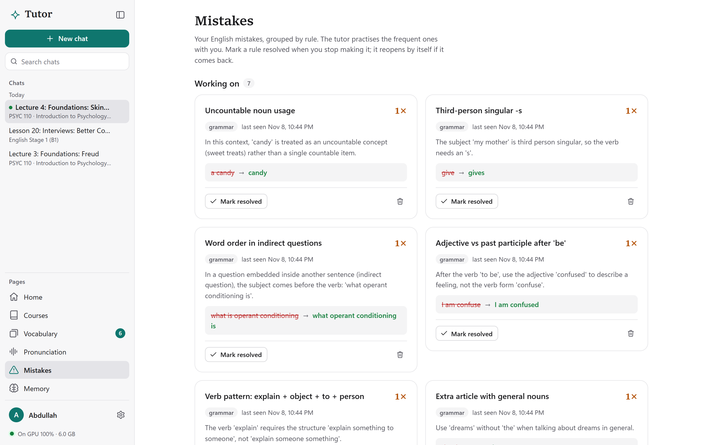
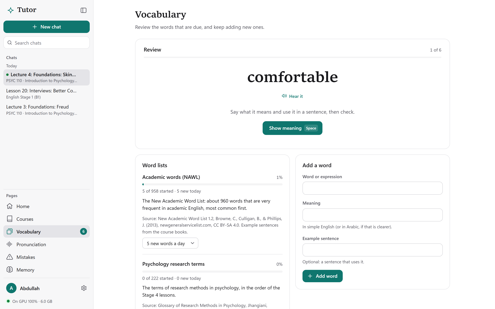
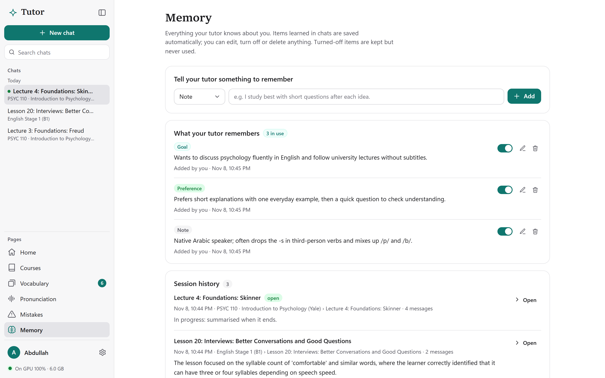
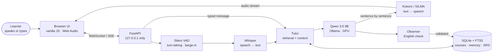

<div align="center">


# Personal Tutor

**A private, voice-first AI study partner that teaches any subject and improves your English while you learn. It runs 100% on your own GPU.**

[](https://www.python.org/)
[](https://fastapi.tiangolo.com/)
[](app/tutor/web/)
[](https://ollama.com/)
[](#requirements)
[](docs/INSTALL.md)
[](#development)
[](LICENSE)

**English** · [العربية](README.ar.md) · [Installation guide](docs/INSTALL.md) · [دليل التثبيت](docs/INSTALL.ar.md)



<sub>A real session. The tutor teaches Yale's PSYC 110 lecture on Skinner and corrects the learner's English under the message without interrupting the lesson. Every screenshot in this README comes from the app running locally on an RTX 5060 Ti.</sub>

</div>

---

## Why I built this

My English was weak, and that was holding me back. I could read a little, but speaking was the real problem: I had no one to practise with, I was too shy to make mistakes in front of people, and lessons were expensive and only covered "language" topics. **What I wanted was a patient speaking partner**: someone to talk with about *anything*, from psychology lectures and science to everyday life, who would quietly fix my grammar and pronunciation while we talked about things I actually cared about.

The tools I found didn't do that. Language apps teach vocabulary drills, not conversations about real subjects. General chatbots don't remember your mistakes, don't track your weak sounds, and send everything you say to the cloud.

So I built my own: **a voice friend that runs entirely on my computer.** It studies real university courses with me, talks with me out loud, interrupts and gets interrupted like a person, remembers what I struggle with, and turns every conversation into English practice.

This project is also my **full-stack portfolio piece**. It covers the whole stack end to end: a real-time audio pipeline, LLM orchestration, a database with full-text search, a GPU-constrained model runtime, a hand-built accessible UI, a one-click Windows installer, and a test suite that drives the UI in a real browser.

> I'm sharing it, together with all the study materials I prepared, so that anyone in the same situation can use it.

---

## What it does

| | |
|---|---|
| 🎙️ **Live voice conversation** | Talk naturally, with no buttons. The tutor detects when you've finished from the silence *and* from the meaning of your sentence (it waits longer after *"because…"*). Interrupt it any time and it stops in about 0.4 s. |
| 📚 **Teaches any subject** | Upload PDFs, TXT or Markdown, or use the 6 bundled courses. Answers are grounded in your material with clickable citations `[S1]`, and Arabic questions are searched in English material. |
| ✍️ **Corrects your English as you go** | Every message, typed or spoken, is checked in the background. You get the mistake, the rule, a short explanation, a more natural phrasing, and **Use it** / **▶ Listen** buttons. |
| 🗣️ **Pronunciation coach** | Say a sentence and each sound is scored against the dictionary (CMU + eSpeak NG). You see which sound you said instead (*"/θ/, heard /t/"*), get a tip for fixing it, and practise with 13 drills built for Arabic speakers. |
| 🧠 **Long-term memory** | Remembers your goals, preferences, recurring mistakes, weak sounds and vocabulary, and summarises each session with a *next step*. You can see, edit, switch off or delete everything it remembers. |
| 🗂️ **Spaced repetition** | Words you ask about and topics you finish come back for review at growing intervals (1, 3, 7, 14, 30, 60 days). It also ships 2 academic word lists (958 + 222 words). |
| 🔤 **Bilingual speech** | Arabic words inside an English answer are spoken in an Arabic voice (SILMA TTS) in the same sentence: *"Cognitive means **إدراكي**…"*. |
| 🔒 **Private by design** | Nothing leaves your machine. The server listens on `127.0.0.1` only and rejects cross-site requests, and your recordings are never saved. |

<table>
<tr>
<td width="50%"><br><sub><b>Voice mode.</b> The orb's motion shows the state (listening, thinking, speaking). The card above it is the automatic summary of the previous chat.</sub></td>
<td width="50%"><br><sub><b>Pronunciation.</b> Each sound is scored, so "three" said as "tree" is caught and comes with a tip for fixing it.</sub></td>
</tr>
<tr>
<td><br><sub><b>Home.</b> What to study now: continue where you stopped, reviews that are due, your weakest sounds and your most frequent mistakes.</sub></td>
<td><br><sub><b>Dark mode</b>, which follows Windows by default.</sub></td>
</tr>
<tr>
<td><br><sub><b>Course and topic picker</b> (<kbd>Ctrl</kbd>+<kbd>K</kbd>), showing each topic's status.</sub></td>
<td><br><sub><b>Mistakes</b>, grouped by rule. The tutor brings the frequent ones back into conversation.</sub></td>
</tr>
<tr>
<td><br><sub><b>Vocabulary</b> with spaced repetition (<kbd>Space</kbd>, then <kbd>1</kbd>–<kbd>4</kbd>).</sub></td>
<td><br><sub><b>Memory</b>: everything the tutor knows about you, fully under your control.</sub></td>
</tr>
</table>

---

## Bundled courses (free to use)

The repository includes **all the study materials I prepared**: about 190 lessons with study guides, answer keys and print-ready PDFs, built from openly licensed university courses and textbooks. The installer loads them into the app automatically.

| Course | Lessons | Built from |
|---|---|---|
| **PSYC 110 · Introduction to Psychology** | 22 | Yale (Paul Bloom), Open Yale Courses: transcripts, slides and a study guide per lecture |
| **English Stage 1 (B1)**: speaking, listening, pronunciation | 34 | Zemlick; Ferguson (Grossmont College), with the books' audio recordings |
| **English Stage 2 (B2)**: academic grammar and writing | 44 | Al Haider (Reedley College); Cui (Harper College) |
| **English Stage 3 (C1)**: academic reading, research and writing | 52 | Hall and Wallace (Georgia State); Winer and Wadell (ASCCC OERI) |
| **English Stage 4**: English for Psychology (research methods) | 37 | Jhangiani, Chiang, Cuttler and Leighton, *Research Methods in Psychology* |
| **Word lists** | 958 + 222 | New Academic Word List (NAWL); research-methods glossary |

Every study guide is written from the source text, and numbers, names and stress marks were checked automatically (for example `scripts/check_guides.py` against the CMU dictionary). The printable PDFs are in `materials/library/<course>/print/`. Licenses and attribution: [materials/README.md](materials/README.md).

---

## Requirements

| | Minimum | Recommended (what it was measured on) |
|---|---|---|
| OS | Windows 10/11, 64-bit | Windows 11 |
| GPU | NVIDIA, **12 GB** VRAM, recent driver | NVIDIA, **16 GB** VRAM (RTX 5060 Ti 16 GB) |
| Disk | 25 GB free | 40 GB free (with the Arabic voice) |
| RAM | 16 GB | 32 GB |
| Other | Internet for the one-time download; Chrome or Edge | Headphones for voice mode |

> Every model runs on the GPU on purpose: if video memory runs out, the app fails with a clear message instead of silently falling back to a slow CPU.

## Quick start (Windows)

1. **Download** this repository: **Code → Download ZIP**, then unzip it to a drive with enough space (e.g. `D:\personal-tutor`), or clone it with Git.
2. **Double-click `Install Personal Tutor.cmd`.** It downloads everything into that folder (portable Ollama, Python, the models), loads the courses and creates a desktop shortcut. You don't need admin rights or to install anything system-wide, and it's safe to run again.
3. **Double-click `Start Personal Tutor.cmd`** (or the desktop shortcut). The app opens in its own window. Use `Stop Personal Tutor.cmd` to free the GPU when you're done.

📖 The **[step-by-step installation guide](docs/INSTALL.md)** covers requirements, what each step does, and troubleshooting. There's an Arabic version too: **[دليل التثبيت بالعربية](docs/INSTALL.ar.md)**.

---

## How it works



**One turn of the conversation:**

1. **Retrieval.** Your question (translated to English keywords if you asked in Arabic) searches the course passages with SQLite FTS5, current topic first.
2. **Context.** The tutor prompt is assembled from your profile, top memories, frequent mistakes, weakest sounds, due vocabulary, your place in the syllabus, and the retrieved passages with source ids.
3. **Streaming.** The reply streams token by token over SSE. In voice mode, each finished sentence goes to Kokoro straight away, so speech starts before the reply is complete.
4. **Observation.** In parallel, the observer analyses *your* message. Corrections are accepted only if the wrong words really appear in what you said, and duplicates are merged before anything is stored.
5. **Reflection.** When a session ends, it's summarised into a summary, a *next step*, and new memories backed by evidence.

### Engineering highlights

- **Real-time voice on consumer hardware.** Streaming STT → LLM → TTS with semantic end-of-turn detection, barge-in, echo handling, and per-turn latency metrics in `logs/live-metrics.jsonl`. It takes about **1.9 s** from the end of your speech to the tutor's voice, all local.
- **VRAM budgeting.** One model and one request at a time, every layer pinned to the GPU (`num_gpu 999`), and the pronunciation model loaded on demand after a free-memory check, then unloaded after 10 idle minutes. The LLM, both voices, STT and the phone model fit in 13 GB.
- **Measured pronunciation scoring.** Goodness of Pronunciation over a wav2vec2 phone recogniser fine-tuned on L2-ARCTIC (learners including Arabic speakers). Thresholds were tuned on half the speakers of *speechocean762* and evaluated on the other half: **2% false alarms** on sounds that all 5 experts judged correct.
- **The LLM never writes to the database.** It *proposes* corrections, words and memories, and a validation layer checks each against your actual text before saving.
- **A frontend with no framework and no build.** ES modules, one stylesheet, light and dark themes, full keyboard support and a visible focus ring. A [design spec](app/tutor/web/DESIGN.md) is enforced by an automated headless-Chrome check that also verifies text contrast on every page.
- **A portable installer.** A PowerShell installer with pinned versions downloads portable Ollama, uv, Python and eSpeak NG, builds the ONNX pronunciation model reproducibly (bit-identical to the one measured), and resumes where it stopped if interrupted.

### Tech stack

| Layer | Technology |
|---|---|
| Backend | Python 3.12, FastAPI, Uvicorn, httpx, Pydantic, WebSockets, SSE |
| Data | SQLite (WAL) with FTS5 full-text search; automatic backups |
| LLM | Qwen 3.5 9B served by Ollama (portable, GPU-only) |
| Speech | faster-whisper (CTranslate2), Kokoro ONNX, SILMA TTS (F5-TTS, PyTorch) in an isolated worker, Silero VAD |
| Pronunciation | wav2vec2-large-xlsr-53 (L2-ARCTIC), ONNX Runtime CUDA, CMU Pronouncing Dictionary, eSpeak NG |
| Frontend | Vanilla JavaScript (ES modules), HTML, CSS, Web Audio API, AudioWorklet |
| Tooling | uv, pytest, a headless Chrome DevTools-protocol UI test, PowerShell |

---

## Measured performance (RTX 5060 Ti 16 GB)

| Metric | Result |
|---|---|
| LLM placement | 100% GPU (34/34 layers) |
| Generation speed | ~67 tokens/s, first token in ~0.1 s |
| End of your speech → tutor's voice | ~1.9 s |
| Barge-in (tutor stops talking) | ~0.4 s |
| Speech to text, 4 s sentence | 0.4–0.5 s |
| Pronunciation check | 0.1 s (short sentence) to 0.25 s (33 words) |
| VRAM with everything loaded | 11.7–13.2 of 16.3 GB |

---

## Project structure

```
personal-tutor/
├── Install Personal Tutor.cmd    one-click installer (scripts/setup.ps1)
├── Start / Stop Personal Tutor.cmd
├── app/tutor/                    the application
│   ├── server.py                 FastAPI routes, security (localhost + same-origin only)
│   ├── tutor.py                  context building, streaming, session reflection
│   ├── live.py                   WebSocket voice: VAD, turn-taking, barge-in
│   ├── voice.py                  Whisper STT, Kokoro TTS, Arabic worker client
│   ├── assessment.py             pronunciation scoring (GOP) on the phone model
│   ├── pronunciation.py, drills.py   dictionary lookups and the 13 drills
│   ├── store.py, db.py           SQLite schema and validated writes
│   ├── srs.py                    spaced repetition
│   ├── materials.py              PDF/TXT/MD extraction, chunking, FTS queries
│   ├── prompts/                  the tutor's prompts (editable, hot-reloaded)
│   └── web/                      the single-page UI and its DESIGN.md
├── workers/arabic_tts/           SILMA TTS in its own environment (PyTorch)
├── materials/                    all course materials (see materials/README.md)
├── scripts/                      installer, launchers, course import and build tools
├── tests/                        unit tests, UI check, voice/model/pronunciation benchmarks
└── docs/                         installation guides, user guide, screenshots
```

Your data (`data/`), logs, models and tools are created locally and are never committed.

## Development

```powershell
. .\scripts\env.ps1                    # project environment (all caches stay inside the folder)
uv run pytest -q                       # 102 tests, no models needed
uv run python tests\ui_check.py out    # the whole UI in headless Chrome, fake model, light + dark screenshots
uv run python tests\model_check.py     # GPU placement, speed, English and psychology answers
uv run python tests\live_check.py      # voice-mode latency (stop the main server first)
```

- **Change the tutor's behaviour** by editing the prompts in [`app/tutor/prompts/`](app/tutor/prompts/). Changes apply immediately, with no restart.
- **Add a course** by uploading files on the **Courses** page, or importing an open textbook with `scripts/import_libretexts.py` / `import_pressbooks.py` / `import_oyc.py`.
- For the full feature-by-feature manual, see the **[user guide (Arabic)](docs/USER_GUIDE.ar.md)**.
- Contributions are welcome. See **[CONTRIBUTING.md](CONTRIBUTING.md)**.

## Known limitations

- Windows and NVIDIA only (by design: everything stays on the GPU).
- Retrieval is keyword-based (FTS5), not yet semantic.
- Scanned PDFs need OCR before upload.
- Pronunciation scoring finds about half of clear errors in free sentences (over 80% in minimal-pair drills) and doesn't judge stress or intonation yet.
- End-to-end voice latency is about 2 s, versus about 0.5 s for cloud speech-to-speech models, because there are three local stages (listen → think → speak).

## License

- **Code:** [MIT](LICENSE).
- **Course materials** in `materials/` keep their original Creative Commons licenses (CC BY, CC BY-NC, CC BY-NC-SA and CC BY-SA, several of them non-commercial). See [materials/README.md](materials/README.md).
- **Models** are downloaded at install time under their own licenses: Qwen 3.5 (Apache 2.0), Whisper (MIT), Kokoro (Apache 2.0), wav2vec2 L2-ARCTIC (Apache 2.0) and SILMA TTS (Apache 2.0).

## Author

Built by **Abdullah**, a full-stack developer who needed a patient English-speaking partner and decided to build one.
If this project helps you practise, a ⭐ on the repository is appreciated, and issues and suggestions are welcome.
